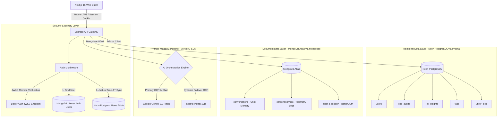

# GreenPulse AI — Server API Gateway

[](#)
[](#)
[](#)
[](#)
[](#)
[](#)

Production-grade REST API backend for GreenPulse AI, an enterprise Environmental, Social, and Governance (ESG) audit and decarbonization intelligence platform. Provides multi-model multimodal OCR bill extraction, AI sustainability consultancy, automated compliance tagging, energy telemetry processing, and a resilient hybrid data layer.

- **Live API Gateway:** [https://greenpulse-server.vercel.app](https://greenpulse-server.vercel.app)
- **Client Web Application:** [https://greenpulse-client.vercel.app](https://greenpulse-client.vercel.app)
- **Frontend Repository:** [https://github.com/saikot05/greenpulse-client](https://github.com/saikot05/greenpulse-client)

---

## System Architecture

GreenPulse Server operates on an enterprise hybrid persistence architecture combining document storage (MongoDB Atlas) and relational storage (PostgreSQL on Neon).



### Hybrid Persistence & JIT User Sync
- **PostgreSQL on Neon (Prisma ORM):** Manages structured relational data: `users`, `esg_audits`, `ai_insights`, `tags`, and `utility_bills`. Uses Neon's connection pooler for runtime API queries and direct connections for schema migrations.
- **MongoDB Atlas (Mongoose ODM):** Stores session-centric and unstructured documents: Better Auth user accounts and sessions, interactive ESG chat logs (`conversations`), and energy telemetry analyses (`carbonanalyses`).
- **Just-In-Time (JIT) User Sync:** When authenticated requests hit the server, `auth.middleware.ts` verifies the token (via Better Auth JWKS or JWT), resolves the user in MongoDB, and automatically upserts or links the corresponding record into Neon PostgreSQL. This ensures foreign-key integrity across audit operations without requiring complex cross-database distributed transactions.

---

## Core AI Features

1. **Multimodal OCR Invoice Parser (`POST /api/v1/ai/parse-bill`)**
   - Ingests PDF or image utility invoices (electricity, gas, water, fuel receipts).
   - High-res rendering with `@napi-rs/canvas` and text parsing with `pdf-parse`.
   - Primary model: `gemini-2.0-flash`. Automatic failover to `pixtral-12b-2409` if rate limits, quota exhaustion, or service errors occur.
   - Extracts structured audit parameters: facility name, facility type, geographical location, billing year, energy usage (kWh), calculated carbon emissions (metric tons CO2e), GHG scope category, risk rating, short summary, and comprehensive overview.

2. **Contextual ESG Consultant Chatbot (`POST /api/v1/ai/chat`)**
   - System persona structured as a Senior ESG Auditor and Decarbonization Strategist.
   - Retains conversation context and history across sessions in MongoDB (`conversations`).
   - Retrieves historical audit context to provide actionable decarbonization roadmaps (Scopes 1, 2, and 3).

3. **Telemetry Carbon & Anomaly Analyzer (`POST /api/v1/ai/analyze-data`, `POST /api/v1/carbon/analyze`)**
   - Ingests high-frequency CSV and JSON energy telemetry logs.
   - Computes baseline carbon benchmarks and detects off-peak spikes, HVAC leaks, and equipment anomalies with remedial suggestions.

4. **Automated Compliance Tagging**
   - Triggers automatically upon audit creation if tags are omitted.
   - Leverages AI NLP evaluation of facility descriptions to generate standardized taxonomy tags (e.g., `#Scope2Spike`, `#RenewableTransition`, `#HVACAnomaly`) for categorized indexing in PostgreSQL.

---

## Environment Variables

Environment variables are the single source of truth for backend configuration. Create a `.env` file in the `greenpulse-server` root directory using the table below:

| Variable | Required | Description | Example Placeholder |
| :--- | :--- | :--- | :--- |
| `PORT` | No | Port for the Express server to listen on (defaults to `5000`). | `5000` |
| `NODE_ENV` | No | Runtime environment mode (`development`, `production`, or `test`). | `development` |
| `CORS_ORIGIN` | Yes | Comma-separated list of allowed frontend origins for CORS. | `http://localhost:3000,https://greenpulse-client.vercel.app` |
| `MONGO_URI` | Yes | MongoDB Atlas connection string for Mongoose. | `mongodb+srv://<username>:<password>@<cluster>.mongodb.net/<dbname>?retryWrites=true&w=majority` |
| `DATABASE_URL` | Yes | Pooled connection string for Neon PostgreSQL (used by Prisma Client runtime). | `postgresql://<user>:<password>@<neon-pooled-host>/<dbname>?sslmode=require` |
| `DIRECT_URL` | Yes | Direct (unpooled) connection string for Neon PostgreSQL (used for Prisma migrations). | `postgresql://<user>:<password>@<neon-direct-host>/<dbname>?sslmode=require` |
| `JWT_SECRET` | No | Secret string for fallback HMAC-SHA256 JWT validation (minimum 32 characters). | `<random-32-character-secret>` |
| `BETTER_AUTH_SECRET` | No | Secret shared with Better Auth for session verification. | `<better-auth-secret>` |
| `BETTER_AUTH_URL` | No | Base URL of Better Auth instance for JWKS discovery (defaults to `http://localhost:3000`). | `http://localhost:3000` |
| `GEMINI_API_KEY` | Yes | Google Gemini API key for OCR invoice parsing and AI services. | `<gemini-api-key>` |
| `MISTRAL_API_KEY` | Yes | Mistral API key for Pixtral 12B OCR failover. | `<mistral-api-key>` |
| `MONGO_SOURCE_DB` | No | Source database name for one-time audit migration (defaults to `greenpulse`). | `greenpulse` |
| `MONGO_DNS_SERVERS` | No | Optional custom DNS resolvers for Atlas SRV lookups on specific networks. | `8.8.8.8,8.8.4.4` |

---

## API Endpoint Registry

All application endpoints are served under the `/api/v1` namespace. Audits, AI insights, and tags are persisted in **PostgreSQL via Prisma**.

### Health Check
| Method | Endpoint | Auth | Description |
| :--- | :--- | :--- | :--- |
| `GET` | `/api/v1/health` | Public | Returns system health, process uptime, and memory consumption. |

### ESG Audits (Stored in PostgreSQL)
| Method | Endpoint | Auth | Description |
| :--- | :--- | :--- | :--- |
| `GET` | `/api/v1/audits` | Public | Retrieves paginated audits with search and filtering by facility type, scope, risk, emissions range, and tags. |
| `POST` | `/api/v1/audits` | Bearer JWT | Validates payload with Zod, generates AI tags if missing, and saves audit to Neon PostgreSQL. |
| `GET` | `/api/v1/audits/:id` | Public | Retrieves a single ESG audit by ID including nested AI insights and tags. |
| `DELETE` | `/api/v1/audits/:id` | Bearer JWT | Deletes an audit if the authenticated user is the author or an admin. Unlinks related telemetry. |

### AI Services & OCR Parser
| Method | Endpoint | Auth | Description |
| :--- | :--- | :--- | :--- |
| `POST` | `/api/v1/ai/parse-bill` | Bearer JWT | Uploads a utility bill (image/PDF, multipart/form-data) for multimodal OCR extraction with Gemini + Pixtral fallback. |
| `POST` | `/api/v1/ai/chat` | Bearer JWT | Sends a message to the AI sustainability consultant; records chat history in MongoDB. |
| `GET` | `/api/v1/ai/chat/history` | Bearer JWT | Retrieves past conversation logs by `sessionId` query parameter. |
| `POST` | `/api/v1/ai/analyze-data` | Bearer JWT | Analyzes uploaded CSV/JSON energy telemetry files using AI models. |
| `POST` | `/api/v1/ai/analyze-telemetry` | Bearer JWT | Alternative telemetry file analysis route. |

### Carbon Telemetry Processing
| Method | Endpoint | Auth | Description |
| :--- | :--- | :--- | :--- |
| `POST` | `/api/v1/carbon/analyze` | Public | Algorithmic telemetry file parsing for carbon emissions and efficiency metrics. |

---

## Database Setup

1. **Prisma Client Generation**
   ```bash
   npm run prisma:generate
   ```

2. **Apply Migrations to Neon PostgreSQL**
   Deploy existing schema migrations using the direct connection (`DIRECT_URL`):
   ```bash
   npm run prisma:deploy
   ```

3. **Optional Database Seeding**
   Populate baseline facility types, demo audits, and tags:
   ```bash
   npm run prisma:seed
   ```

---

## Scripts

| Script | Command | Purpose |
| :--- | :--- | :--- |
| `dev` | `npm run dev` | Starts server with live reloading via `tsx watch`. |
| `build` | `npm run build` | Generates Prisma client and compiles TypeScript to `dist/`. |
| `start` | `npm start` | Runs the compiled production server from `dist/start.js`. |
| `prisma:generate` | `npm run prisma:generate` | Regenerates the Prisma Client. |
| `prisma:migrate` | `npm run prisma:migrate` | Creates and applies new migrations in development. |
| `prisma:deploy` | `npm run prisma:deploy` | Applies pending migrations to production/staging databases. |
| `prisma:studio` | `npm run prisma:studio` | Launches Prisma Studio GUI for exploring Neon database records. |
| `prisma:seed` | `npm run prisma:seed` | Seeds initial benchmark ESG audits and users into PostgreSQL. |
| `db:backfill` | `npm run db:backfill` | **One-time maintenance:** Backfills existing MongoDB users into Neon PostgreSQL with verified-email linking. |
| `db:migrate-audits` | `npm run db:migrate-audits` | **One-time maintenance:** Migrates legacy MongoDB audits into Neon PostgreSQL. Runs in **dry-run mode by default**; pass `--apply` to commit changes (`npm run db:migrate-audits -- --apply`). |

---

## Local Installation & Setup

### Prerequisites
- **Node.js** >= 18.0.0
- **npm** or compatible package manager
- Accessible **MongoDB Atlas** database
- Accessible **Neon PostgreSQL** database

### Step-by-Step Setup

1. **Clone this repository:**
   ```bash
   git clone https://github.com/saikot05/greenpulse-server.git
   cd greenpulse-server
   ```

2. **Install dependencies:**
   ```bash
   npm install
   ```

3. **Configure Environment Variables:**
   Create a `.env` file in the project root:
   ```env
   PORT=5000
   NODE_ENV=development
   CORS_ORIGIN=http://localhost:3000
   MONGO_URI=mongodb+srv://<username>:<password>@<cluster>.mongodb.net/greenpulse?retryWrites=true&w=majority
   DATABASE_URL=postgresql://<user>:<password>@<neon-pooled-host>/neondb?sslmode=require
   DIRECT_URL=postgresql://<user>:<password>@<neon-direct-host>/neondb?sslmode=require
   JWT_SECRET=<random-32-character-secret>
   BETTER_AUTH_SECRET=<better-auth-secret>
   BETTER_AUTH_URL=http://localhost:3000
   GEMINI_API_KEY=<gemini-api-key>
   MISTRAL_API_KEY=<mistral-api-key>
   ```

4. **Initialize Database:**
   ```bash
   npm run prisma:deploy
   npm run prisma:seed
   ```

5. **Start Development Server:**
   ```bash
   npm run dev
   ```
   The API will be accessible at `http://localhost:5000`.

---

## Deployment Notes

- **Vercel Serverless Deployment:** The repository is configured for deployment on Vercel (`dist/api/index.js` entrypoint via `vercel.json`).
- Ensure all required environment variables (`MONGO_URI`, `DATABASE_URL`, `DIRECT_URL`, `CORS_ORIGIN`, `GEMINI_API_KEY`, `MISTRAL_API_KEY`, `BETTER_AUTH_SECRET`, `BETTER_AUTH_URL`) are defined in your Vercel Project Settings.
- The `postinstall` script runs `prisma generate` to ensure Prisma client binaries are available within the serverless environment.
